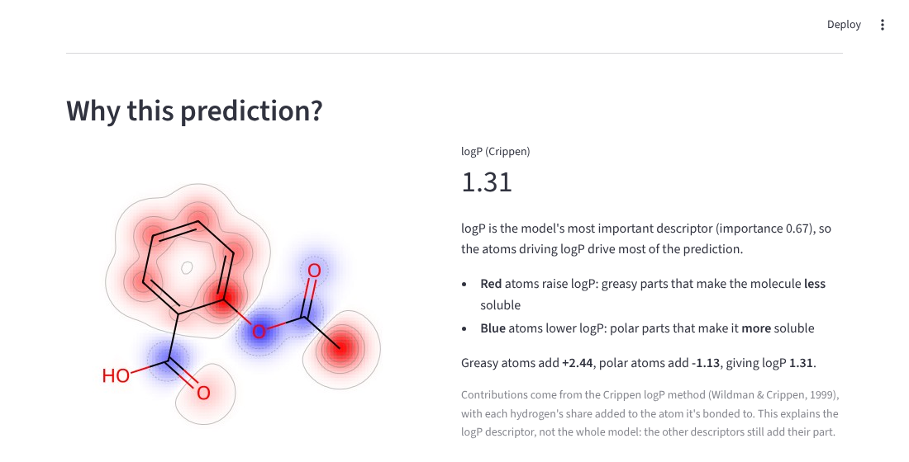
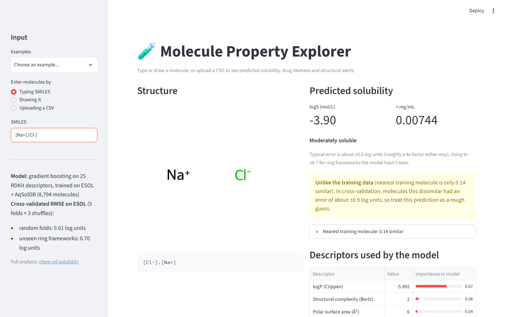
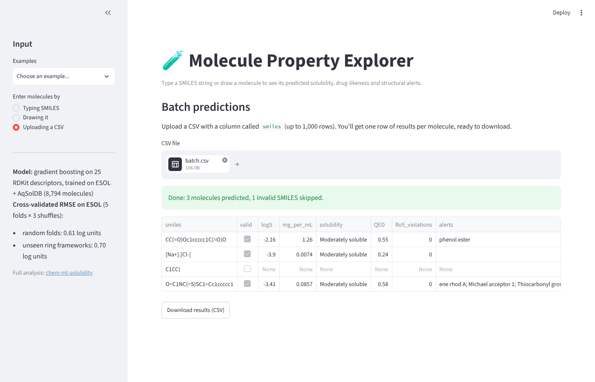

# Molecule Property Explorer

A Streamlit app that predicts a molecule's aqueous solubility from its structure, explains the
prediction, and checks drug-likeness and structural alerts. Type a SMILES string, draw the molecule,
or upload a CSV of many.

It builds on my earlier analysis project, [chem-ml-solubility](https://github.com/Ash679-ux/chem-ml-solubility).

> Live demo: _link coming after deployment_


## Features

- **Predicted solubility** in logS and mg/mL, with the model's typical error
- **Why this prediction?** A heatmap of each atom's contribution to logP, the model's most important descriptor
- **Applicability-domain warning** when a molecule is unlike the training data, with the nearest training molecule and its measured value
- **Drug-likeness:** QED score and Lipinski's rule of five
- **Structural alerts:** PAINS and Brenk flags, with the matched atoms highlighted
- **Three ways in:** type SMILES, draw in a Ketcher editor, or upload a CSV for batch predictions

| Why this prediction? | Structural alerts |
| --- | --- |
|  |  |
| **Applicability-domain warning** | **Batch mode** |
|  |  |

## Model

Gradient boosting (scikit-learn's `HistGradientBoostingRegressor`) on 25 RDKit descriptors: the 7 from
chem-ml-solubility, a P=O count, ring counts, sp³ fraction, molar refractivity, surface area, complexity
and element counts. It is trained on ESOL and AqSolDB together (8,794 molecules).

All scores are measured on ESOL with the same 5-fold cross-validation (3 shuffles) as chem-ml-solubility.
AqSolDB only ever joins the training folds, with every ESOL compound removed, and in scaffold folds every
compound sharing a test molecule's ring framework removed too.

| Model | RMSE, random folds | RMSE, unseen ring frameworks | Error on P=O compounds |
| --- | --- | --- | --- |
| Random forest, 7 descriptors, ESOL only (chem-ml-solubility) | 0.709 | 0.804 | 2.49 |
| This app | 0.61 | 0.69 | 0.5 |

Errors are in log units (mol/L). Adding AqSolDB fixed the P=O compounds; the extra descriptors and
gradient boosting improved everything else. The Ulrich et al. dataset scored the same overall but worse
on phosphates, because it drops the most soluble compounds (logS above 0.5).

### How far to trust a prediction

Error grows for molecules unlike the training data. Similarity here is the Tanimoto similarity of Morgan
fingerprints (radius 2) to the nearest training molecule, measured in the cross-validation above:

| Similarity to nearest training molecule | ESOL molecules | RMSE |
| --- | --- | --- |
| below 0.3 | 22 | 0.91 |
| 0.3 to 0.4 | 58 | 0.71 |
| 0.4 to 0.5 | 99 | 0.65 |
| 0.5 to 0.7 | 561 | 0.54 |
| 0.7 to 1.0 | 386 | 0.64 |

Below 0.3 the app warns that the prediction is a rough guess. Sodium chloride, for example, scores 0.14
and gets a badly wrong prediction (logS -3.9; the real value is about +0.8). The top band isn't the most
accurate because near-duplicates in different datasets often have conflicting measurements.

### Limitations

- Structural alerts are flags, not verdicts: aspirin triggers the Brenk phenol ester alert.
- The rule of five is a guide; many successful drugs, such as antibiotics, break it.
- The "why" view explains logP, which carries about two-thirds of the model's importance, not the whole model.
- Fully miscible liquids such as triethyl phosphate can be predicted too low, since their logS isn't well defined.

## Running it

```bash
python -m venv .venv && source .venv/bin/activate
pip install -r requirements.txt
streamlit run app.py
```

The trained model is in the repo (`models/solubility_model.joblib`, 2.6 MB), so the app runs straight away.

```bash
python train_model.py   # retrain: downloads AqSolDB, cross-validates, saves the model
pytest                  # run the 27 tests (also run by GitHub Actions on every push)
```

Library versions are pinned because a saved scikit-learn model only loads reliably with the version that
trained it. On WSL, training uses 4 threads, since using every core can stall it; override with
`OMP_NUM_THREADS=8 python train_model.py`.

## Deploying

The repo is ready for Streamlit Community Cloud: pinned packages in `requirements.txt`, the system
libraries RDKit needs for drawing in `packages.txt`, and the model committed. Deploy from
share.streamlit.io with main file `app.py` and Python 3.13.

## Project layout

| File | What it does |
| --- | --- |
| `app.py` | The Streamlit interface |
| `chem_utils.py` | Chemistry and model code: features, predictions, alerts, logP map, domain check |
| `train_model.py` | Trains and evaluates the model, saves it to `models/` |
| `tests/` | pytest suite |

## Data

- ESOL (Delaney, 2004), `data/delaney-processed.csv`, from [DeepChem / MoleculeNet](https://github.com/deepchem/deepchem)
- AqSolDB (Sorkun et al., 2019), downloaded when retraining, from [github.com/mcsorkun/AqSolDB](https://github.com/mcsorkun/AqSolDB)
