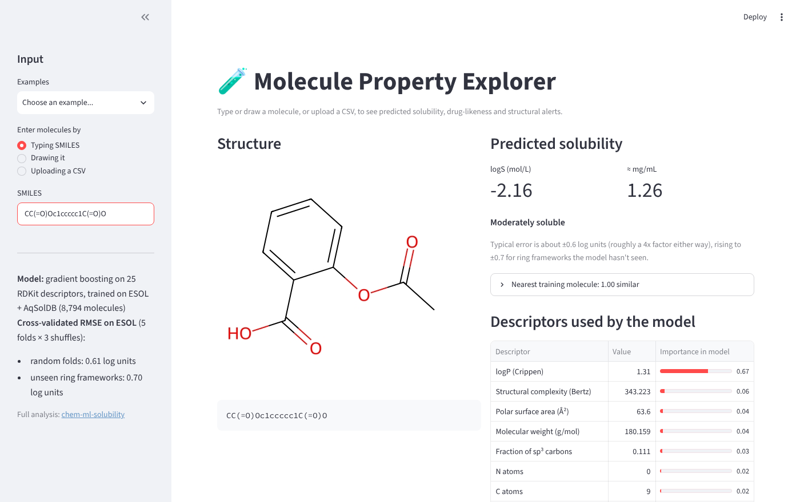
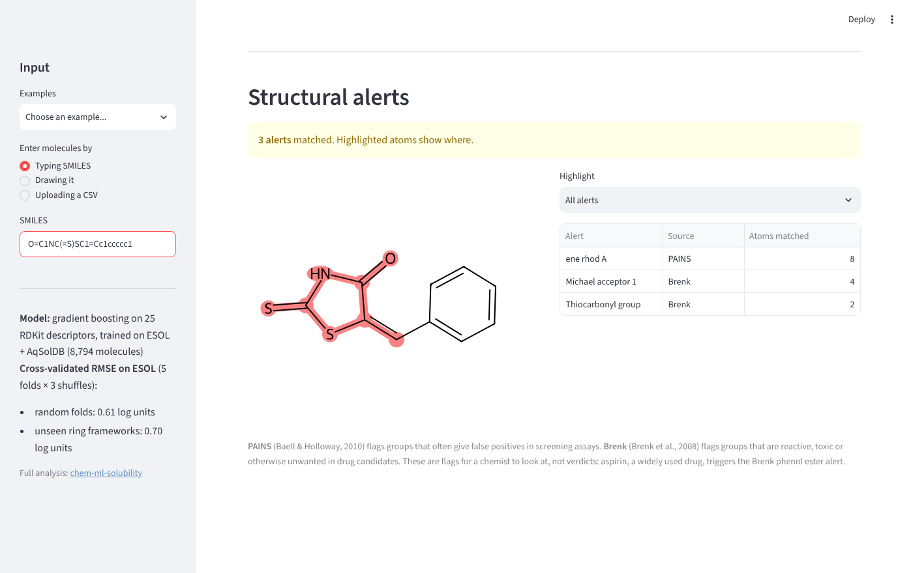

# Molecule Property Explorer

A Streamlit web app that predicts a molecule's aqueous solubility from its structure and explains the
prediction, alongside drug-likeness and structural alerts. Type a SMILES string, draw the molecule, or
upload a CSV of many.

Builds on my earlier analysis project, [chem-ml-solubility](https://github.com/Ash679-ux/chem-ml-solubility).

> Live demo: _link goes here after deployment_



## Features

- **Predicted solubility** (logS and mg/mL) with a plain-English label and the model's typical error
- **Why this prediction?** A heatmap of each atom's contribution to logP, the model's most important descriptor
- **Applicability-domain warning** when a molecule is unlike anything in the training data, with the nearest training molecule and its measured logS
- **P=O note** for phosphates and phosphonates, the model's historically hardest class
- **Descriptor table** showing all 25 descriptors the model uses, sorted by importance
- **Drug-likeness:** QED score and Lipinski's rule of five
- **Structural alerts:** PAINS and Brenk substructure flags, with the matched atoms highlighted
- **Three ways in:** type SMILES, draw the molecule in a Ketcher editor, or upload a CSV for batch predictions

| Why this prediction? | Structural alerts |
| --- | --- |
|  |  |
| **Applicability-domain warning** | **Batch mode** |
|  |  |

## Model

Histogram gradient boosting on 25 RDKit descriptors (the 7 from chem-ml-solubility, a P=O count,
ring counts, sp³ fraction, molar refractivity, surface area, complexity and element counts),
trained on ESOL + AqSolDB (8,794 molecules).

Scored on ESOL with the same 5-fold cross-validation (3 shuffles) as chem-ml-solubility. AqSolDB
is only ever added to the training folds, with every ESOL compound removed, and in scaffold folds
every compound sharing a test-fold ring framework removed too.

| Model | RMSE, random folds | RMSE, unseen ring frameworks | Error on P=O compounds |
| --- | --- | --- | --- |
| Random forest, 7 descriptors, ESOL only (chem-ml-solubility) | 0.709 | 0.804 | 2.49 |
| This app: gradient boosting, 25 descriptors, ESOL + AqSolDB | 0.61 | 0.69 | 0.5 |

Errors are in log units of mol/L. Adding AqSolDB fixed the P=O compounds; the extra descriptors and
gradient boosting improved everything else. Ulrich et al.'s dataset scored the same overall but worse
on phosphates, because its logS > 0.5 cutoff removes the most soluble ones.

### How far to trust a prediction

The error grows for molecules unlike the training data. Similarity here is the Tanimoto similarity of
Morgan fingerprints (radius 2) between a test molecule and its nearest training molecule, measured in
the random-fold cross-validation above:

| Similarity to nearest training molecule | ESOL molecules | RMSE |
| --- | --- | --- |
| below 0.3 | 22 | 0.91 |
| 0.3 to 0.4 | 58 | 0.71 |
| 0.4 to 0.5 | 99 | 0.65 |
| 0.5 to 0.7 | 561 | 0.54 |
| 0.7 to 1.0 | 386 | 0.64 |

Below 0.3 the app warns that the prediction is a rough guess. Sodium chloride, for example, scores 0.14
and gets a badly wrong prediction (logS -3.9 against a real value near +0.8), which is exactly the case
the warning is for. The top band is not the most accurate because near-duplicates in different datasets
often carry noisy, conflicting measurements.

### Limitations

- **Structural alerts are flags, not verdicts.** Aspirin, a widely used drug, triggers the Brenk phenol ester alert.
- **The rule of five is a guide.** Many successful drugs break it, such as antibiotics and natural products.
- **The "why" view explains logP only.** logP carries about two-thirds of the model's importance; the other descriptors add the rest.
- **Very soluble liquids** such as triethyl phosphate can still be predicted too low: logS for fully miscible liquids is not well defined.

## Run locally

```bash
python -m venv .venv && source .venv/bin/activate
pip install -r requirements.txt
streamlit run app.py
```

The trained model (`models/esol_model.joblib`, 2.6 MB) is in the repo, so the app runs straight away.
To retrain it:

```bash
python train_model.py      # downloads AqSolDB, cross-validates, saves the model
python chem_utils.py       # smoke test
pytest                     # 27 tests
```

On WSL, training caps itself at 4 threads, because using every core can stall gradient boosting.
Override with `OMP_NUM_THREADS=8 python train_model.py`. Library versions are pinned in
`requirements.txt` because a saved scikit-learn model only loads reliably with the version it was
trained with.

Tests run automatically on every push and pull request (GitHub Actions).

## Deploying

The app is set up for Streamlit Community Cloud: `requirements.txt` has pinned Python packages,
`packages.txt` has the system libraries RDKit's drawing code needs, and the model is committed.
Deploy from share.streamlit.io with main file `app.py` and Python 3.13.

## Data

- `data/delaney-processed.csv`: ESOL (Delaney, 2004) as distributed by
  [DeepChem / MoleculeNet](https://github.com/deepchem/deepchem)
- AqSolDB (Sorkun et al., 2019), downloaded when retraining from
  [github.com/mcsorkun/AqSolDB](https://github.com/mcsorkun/AqSolDB)

## Stack

RDKit, scikit-learn, Streamlit, streamlit-ketcher, pandas, NumPy, joblib, pytest.
